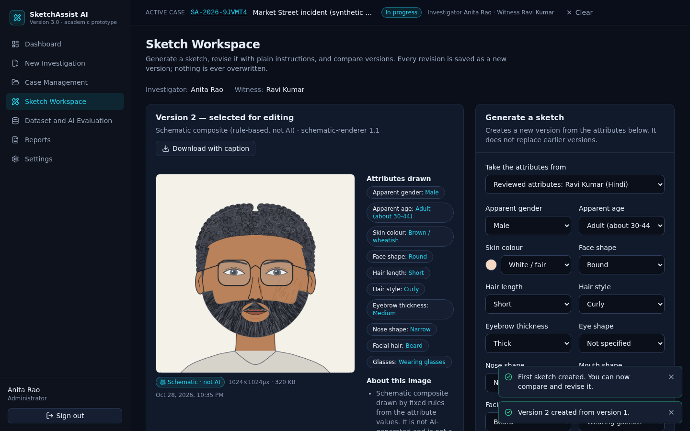
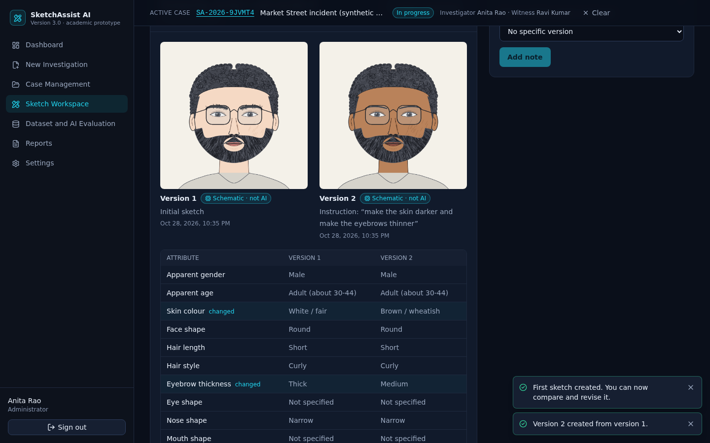
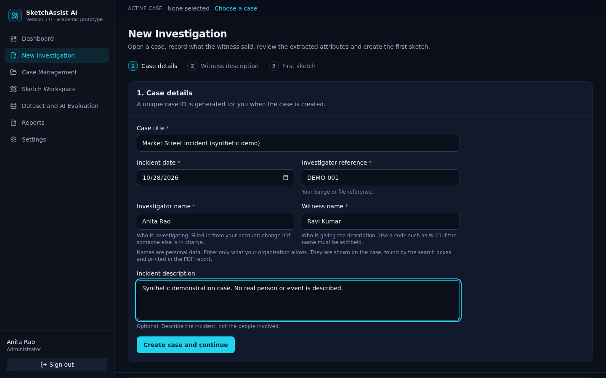
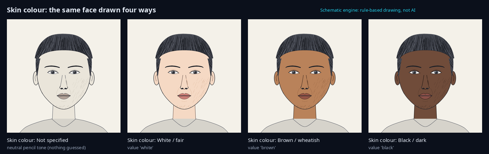

# SketchAssist AI 3.0

A multilingual (English · ಕನ್ನಡ Kannada · हिन्दी Hindi) **forensic sketch assistance and case management** system. An
investigator opens a case, records what a witness said, reviews the facial attributes extracted from those words,
generates a sketch, revises it with plain instructions, compares versions side by side and prints a PDF report.
Academic prototype: **React + TypeScript + Vite** (frontend), **Python FastAPI + SQLAlchemy + SQLite** (backend).

> **Preliminary investigative aid - requires human review.** The system does **not** identify people: no face recognition, no
> face matching, no suspect search. Its output must never be treated as evidence of identity.



## What it does (and what it honestly does not)

| Area | Status |
|---|---|
| **Dashboard** - case counts, status breakdown, sketch / description / note totals, searchable case table, recent activity | all numbers counted from the database; no sample data |
| **New investigation** - case form (unique ID `SA-2026-XXXXXX`, **investigator name, witness name**), witness description, attribute review, first sketch | working |
| **Case management** - search, filter, sort, edit, close, **reopen**, delete, notes; the selected case persists across pages | working |
| **Multilingual parser** (EN / HI / KN) - editable attribute *estimates* with the witness's own words as evidence, phrases it did not understand listed, original text preserved, identical canonical values across languages | rule-based (not a trained model); Hindi / Kannada word lists **not reviewed by native speakers** |
| **Sketch workspace** - generate, revise by instruction (really changes the picture, **including the skin colour**), version history, side-by-side comparison with attribute diff, select for editing, download, versions never overwritten | working with the **schematic engine** (rule-based drawing, **not AI**, labelled everywhere) |
| **AI engines** - Hugging Face (Qwen-Image, Apache-2.0), OpenAI, local diffusers behind one adapter interface | implemented and unit-tested with stand-ins; **never run against a live service** (no credentials here). Unconfigured = "setup required", never a silent substitute |
| **Dataset and AI Evaluation** - installed datasets with real counts (zero if absent), licences / access / citations, engine status, last evaluation date, parser evaluation with *n* and caveats | real numbers only |
| **Reports** - PDF with metadata (**investigator and witness names**), witness text (Hindi / Kannada print correctly), attributes, selected sketch with provenance caption, version history with instructions, notes, methods & limitations, timestamp, disclaimers | working |
| **Security** - hashed passwords, signed tokens, per-user authorisation, login throttling, validated input, safe file handling, CSP / security headers, camera & microphone denied | see [docs/ARCHITECTURE.md](docs/ARCHITECTURE.md) |

The full list of completed features, limitations and remaining work is in **[docs/STATUS.md](docs/STATUS.md)** - please read the
limitations before relying on anything here.



## Skin colour, and who is investigating

* **Skin colour** is an attribute with three values: **White / fair**, **Brown / wheatish**, **Black / dark**. Choose it in any attribute
  editor (the dropdown shows the colour that will be drawn), or let the parser read it from the witness's words in English, Hindi or
  Kannada (*fair skin*, *wheatish complexion*, *dark-skinned*, *उसका रंग गोरा था*, *ಕಪ್ಪು ಚರ್ಮ* ...). Instructions work too:
  *make the skin brown*, *make the skin darker / lighter*. The schematic engine really paints it; AI engines receive it in their
  prompt. The colour of hair, clothes or a mask is **not** read as a skin colour, and hair / eye colour are not supported yet.
* **Investigator name** and **witness name** are asked for when a case is opened (the investigator's name is filled in from your account;
  change it if someone else is in charge). They appear on the case, in the header bar, in the case lists, in the search boxes and in the
  PDF report. A witness who must stay anonymous can be recorded with a code such as `W-01`. Names are personal data: enter only what your
  organisation allows.
* **Cases made with an earlier version keep working.** The database upgrades itself when the backend starts (two columns are added, nothing
  is deleted); just restart the backend. Older cases show "Not recorded" until you open the case and press **Edit**.





## Quick start on Windows with VS Code (beginner friendly)

**Install once**

1. [Visual Studio Code](https://code.visualstudio.com/) and its extensions *Python* and *Tailwind CSS IntelliSense* (optional but helpful).
2. [Node.js](https://nodejs.org/) LTS - version **20.19 or newer** (or 22.12+). Check: open a terminal and run `node --version`.
3. [Python](https://www.python.org/downloads/) **3.11 or newer** (tested with 3.13). In the installer tick **"Add python.exe to PATH"**. Check: `py --version`.

**Open the project**: VS Code -> *File* -> *Open Folder…* -> choose this folder (the one containing `package.json`).
Open a terminal inside VS Code: *Terminal* -> *New Terminal* (PowerShell).

**1. Start the backend** (terminal 1)

```powershell
cd backend
py -3 -m venv .venv
.\.venv\Scripts\Activate.ps1
python -m pip install --upgrade pip
pip install -r requirements.txt
copy .env.example .env
python -m uvicorn app.main:app --reload --port 8000
```

* If PowerShell says *"running scripts is disabled"*, run `Set-ExecutionPolicy -Scope Process -ExecutionPolicy Bypass` once in that terminal, then repeat the `Activate.ps1` line.
* The database is created automatically on first start (`backend/storage/`). Interactive API docs: <http://localhost:8000/docs>.
* In VS Code press *Ctrl+Shift+P* -> *Python: Select Interpreter* -> pick `backend\.venv`.

**2. Start the frontend** (terminal 2: click the **+** in the terminal panel)

```powershell
npm install
npm run dev
```

Open **<http://localhost:5173>**. (`npm install` uses the project's `.npmrc`, which sets `legacy-peer-deps=true`; this works around a
bug in npm 10 with Vite 8 peer dependencies.)

**3. First use**: click **Create one**, register (the **first account on a new installation becomes the administrator**, which is needed for
dataset inspection and evaluation), accept the responsible-use statement, then *New Investigation*.

**Optional - one server instead of two**: `npm run build`, then run only the backend and open <http://localhost:8000> (FastAPI serves the built app).

**Optional - switch an AI engine on**: put your own credentials in `backend\.env` (for example `HF_TOKEN=hf_...`), restart the backend and check the
engine on *Dataset and AI Evaluation*. See [docs/MODEL_SELECTION.md](docs/MODEL_SELECTION.md). Without credentials the app works fully with the
schematic engine and clearly says the AI engines need setup.

> Windows note: these instructions follow the standard Windows / PowerShell workflow but were **developed and verified on Linux**; the commands
> have not been run on a Windows machine.

## Try it with a synthetic example

*New Investigation* -> title `Demo`, reference `DEMO-1` -> language **Hindi** -> paste
`वह आदमी लगभग 35 साल का था। उसका चेहरा गोल, भौंहें मोटी, नाक पतली और छोटे घुंघराले बाल थे। दाढ़ी थी और चश्मा पहना था।` -> *Read description*
(the table shows each estimate next to the witness's words) -> save -> *Generate first sketch* -> in the workspace type
`remove the glasses and make the eyebrows thinner` -> *Create revision* -> tick both versions -> *Compare selected* -> *Reports* -> *Download PDF report*.
The same face described in Kannada or English gives the same attributes.

## Tests and checks

```powershell
# backend (from the backend folder, venv active)
python -m pytest

# frontend (project root)
npm test              # unit + component tests (Vitest, Testing Library)
npm run lint
npm run typecheck
npm run build

# end to end in a real browser: a user journey + an automated accessibility scan (axe-core).
# The backend must be running (serving the built frontend) on a FRESH database, because the first account becomes the administrator.
npx playwright install chromium
npm run test:e2e
# for a second run, restart the backend with an empty backend\storage folder first
```

Latest results are recorded in [docs/STATUS.md](docs/STATUS.md). All test data is synthetic.

## Project structure

```
package.json, vite.config.ts, tsconfig*.json, index.html     frontend toolchain (Vite, TypeScript, Tailwind v4)
src/
  components/   UI primitives (ui/), domain components, providers/
  pages/        Dashboard, NewInvestigation, Cases, CaseDetail, Workspace, Datasets, Reports, Settings, auth pages
  layouts/      AppShell, AuthLayout
  services/     http.ts (fetch wrapper), api.ts (typed endpoints), storage.ts
  hooks/        useAsync, contexts (auth, vocabulary, active case, toasts)
  types/        api.ts (mirrors the backend schemas)      utils/    formatting, errors, download
e2e/            Playwright end-to-end test
backend/
  app/{api,models,schemas,services,core}   FastAPI application
  datasets/{external,custom,processed,metadata}
  scripts/      init_db, create_user, validate_custom_dataset, inspect_datasets, evaluate_parser, generate_* ...
  tests/        pytest suite
  requirements.txt  .env.example  README.md
docs/           ARCHITECTURE, MODEL_SELECTION, DATASETS, EVALUATION, STATUS, API (generated), openapi.json
```

## Documentation

* [backend/README.md](backend/README.md) - backend setup, configuration, scripts, API overview
* [docs/ARCHITECTURE.md](docs/ARCHITECTURE.md) - design, data model, security
* [docs/MODEL_SELECTION.md](docs/MODEL_SELECTION.md) - which AI models were considered, licences, decision, what is unverified
* [docs/DATASETS.md](docs/DATASETS.md) - CUFS / CUFSF / UoM-SGFS findings, the custom dataset format and review workflow
* [docs/EVALUATION.md](docs/EVALUATION.md) - parser evaluation method, results, history, caveats
* [docs/STATUS.md](docs/STATUS.md) - completed features, limitations, remaining work, test results
* [docs/API.md](docs/API.md) - every endpoint, generated from the code (also live at `/docs` and `/redoc`)

## Responsible use and licences

A case records the investigator's name and the witness's name (shown on the case, found by the search boxes and printed in the PDF). Names are
personal data: enter only what your organisation permits (a code such as `W-01` is fine for a witness who must stay anonymous) and never enter
personal details about a suspect. Sketches are aids, not photographs; do not publish them
without authorisation. Hindi / Kannada results need careful checking. Code: academic project. Bundled fonts: Noto Sans / Noto Sans
Devanagari / Noto Sans Kannada, SIL Open Font License 1.1 (licence texts in `backend/app/assets/fonts/`). Dataset citations and
terms are in [docs/DATASETS.md](docs/DATASETS.md); the three published datasets are **not** included or downloaded.
